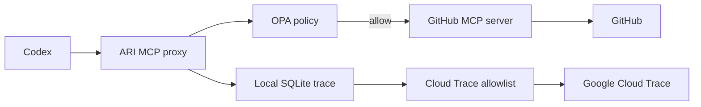

# Handoff: ARI Codex GitHub MCP and Cloud Trace demo

Updated 2026-11-26. This handoff records the work from the first Cloud Trace exporter request through the merged GitHub MCP demo and the local dashboard button.

## Current state

PR [#12](https://github.com/Umoren/agent-runtime-inspector/pull/12), **Route Codex GitHub MCP through ARI**, merged to `main` at `1de7a30fc7e73a398671a595570e519b0fa966fb` on 2026-11-26 at 12:49 UTC. It removed the Merge adapter and Vercel plus Merge example, added the generic upstream GitHub MCP demo, kept the Cloud Trace allowlist CLI, and updated the docs.

The per-run dashboard button is a follow-up change. It is present in this worktree, but it is not committed, pushed, or in a PR. The updated dashboard is running from this worktree at `http://localhost:3006`. The button has not been clicked. No Cloud Trace export has been sent through the button.

## What the demo proves

Codex connects to ARI as an MCP client. ARI selects demo context, asks Open Policy Agent (OPA) for an authorization decision, and forwards allowed calls to the official GitHub MCP server over Streamable HTTP. The policy allows `issue_write` with `method=create` only for the configured repository and the selected checkout ticket.

The disposable private repository is `Umoren/ari-codex-mcp-demo-20261126`. A successful call created issue #1. A request for a different repository was denied before the upstream tool call. Its ARI trace contains `authorization.decided: deny` and `tool.blocked`, with no `tool.called` event. The proxy test at `packages/proxy/src/server.test.ts:364` also checks that the upstream call mock receives no calls after a deny decision.

The merged exporter tests serialize every span from a fixture based on the example's support data. They check that the support ticket title, private finance note title, customer email, tool result text, and principal ID stay out of the spans. They also check matching decision IDs across context, authorization, and tool spans, error status for a deny, and default removal of unknown payload fields. PR #12's recorded `pnpm test` run passed.

## Data sent to Cloud Trace

The exporter creates one root span named `ari.run` and one child span for each event. `tool.completed` and `model.completed` use their recorded latency. Other event spans have zero duration. Shared attributes are event type, path, run ID, timestamp, and any available provenance IDs. Event payload fields come from this explicit allowlist:

| Event | Payload fields |
| --- | --- |
| `run.started` | `scenario` |
| `context.selected`, `context.excluded` | `sourceType`, `permissionRule` |
| `tool.listed` | `upstreamId`, `upstreamType`, `toolCount`, `inventoryHash` |
| `tool.called` | `toolName`, `upstreamId` |
| `tool.completed` | `toolName`, `upstreamId`, `status`, `latencyMs` |
| `tool.blocked` | `toolName`, `upstreamId`, `policy` |
| `authorization.decided` | `toolName`, `upstreamId`, `decision`, `policyId`, `policyVersion` |
| `model.called` | `taskType`, `provider`, `model` |
| `model.completed` | `provider`, `model`, `status`, `latencyMs`, `inputTokens`, `outputTokens` |
| `run.completed` | `status` |

Each event span has `ari.fields_kept_local`, which counts dropped payload fields. The exporter drops titles, reasons, source IDs, arguments, results, error messages, summaries, user and principal IDs, purposes, route reasons, and tool inventories.



ARI records MCP activity that passes through its gateway. It does not record Codex prompts or Codex's built-in shell and editor calls. The demo shows policy decisions and tool calls at the ARI boundary. It is not a full Codex execution trace.

## Chronology

All times below are UTC. The dates and times come from this Codex session transcript.

1. **2026-11-25, 18:39.** The original request asked for a small OpenTelemetry exporter. The exporter had to keep prompts, tool arguments, results, identities, and customer data local. Only explicit allowlisted event fields could go to Cloud Trace. The request also specified span shapes, CLI flags, tests, and a proxy test for denied calls.
2. **2026-11-25, 18:51 to 18:54.** Samuel confirmed the OpenTelemetry approach and asked for setup steps. `gcloud` was not installed when `gcloud auth application-default login` first ran.
3. **2026-11-26, 09:23 to 09:41.** Samuel reviewed available Google Cloud projects and set `GOOGLE_CLOUD_PROJECT=absolute-dahlia-515909-c4`. He ran `gcloud services enable cloudtrace.googleapis.com`. The first `pnpm --filter` command ran from a different checkout that did not contain the exporter package, so pnpm reported that no projects matched.
4. **2026-11-26, 09:47 to 10:06.** The exporter ran from the `makara` checkout, but the collector was not running on port 4319. `pnpm dev` in another checkout started the collector on 4319 and dashboard on 3005. The first `--latest` export selected a run from July 17, outside Cloud Trace's 14-day ingestion window, and failed with `INVALID_ARGUMENT`. A timestamp check was added. A fresh `model=manual` run then exported successfully with context, model, and completion spans. It did not call a live model or external tool.
5. **2026-11-26, 10:04 to 10:44.** Samuel asked for a real ARI run, then chose to remove Merge from the demo. The team compared provider options and chose the generic MCP upstream already supported by ARI. Codex would act as the MCP client and call the official GitHub MCP server through ARI.
6. **2026-11-26, 11:09.** Samuel authorized a disposable GitHub repository and the live demo. The repository was created as `Umoren/ari-codex-mcp-demo-20261126`. The OPA policy uses a default deny rule and allows issue creation only for the selected demo context and configured repository.
7. **2026-11-26, 11:42.** Samuel reported that Docker was running. The allowed and denied issue calls had already run through the verified GitHub MCP v2.3.0 Linux binary. After Docker became available, the server moved to container `ari-github-mcp-demo` at `127.0.0.1:8082`, and a new context call succeeded. No new issue call was tested against the container. OPA used `127.0.0.1:8181`. The current container state was not rechecked during this handoff.
8. **2026-11-26, 12:43 to 12:49.** Samuel asked to push the code, then asked to create and merge the PR. PR #12 merged at 12:49 UTC. Its PR description records passing `pnpm install`, `pnpm typecheck`, `pnpm test`, `pnpm docs:build`, and package lint for the exporter, proxy, and web app. Root lint still reports existing errors in unchanged docs and CLI files.
9. **2026-11-26, 12:53.** Samuel asked for a dashboard button because the exporter was CLI-only. The implementation uses a server-side API route and shares the exporter service with the CLI. This keeps Google credentials out of the browser and sends the same allowlisted spans.
10. **2026-11-26, 13:24.** Samuel asked for a complete handoff. This file and the companion decision log record the current state.

## Cloud Trace history

The chosen project ID is `absolute-dahlia-515909-c4`. The transcript does not establish whether Samuel created this project for ARI or selected an existing project. Do not infer that it is the Gmail project.

The session records three successful CLI exports to this project:

- Fresh manual run trace ID: `bfcd99669319d43fd164dbfba8f78dd5`. It had context, model, and completion spans. It did not call a live model or tool.
- Allowed run trace ID: `98e858e15dbef95efffe7475fa2212b0`.
- Denied run trace ID: `862061ce6ba83b932507a59128c568cc`.

The first failed `--latest` export selected a July 17 run that was older than Cloud Trace's 14-day ingestion window. The timestamp guard now reports this condition before export.

The direct package `@google-cloud/opentelemetry-cloud-trace-exporter` emitted a deprecation warning. The warning said the package would be archived after 2026-10-30. The PR's live export succeeded. The current implementation still uses that exporter and the README notes a future move to OpenTelemetry Protocol (OTLP).

The CLI remains available for a preview or a direct export:

```bash
pnpm --filter @ari/example-cloud-trace-export dev -- --latest --dry-run
pnpm --filter @ari/example-cloud-trace-export dev -- --run <runId>
```

If Application Default Credentials need setup, run `gcloud auth application-default login`. Set `GOOGLE_CLOUD_PROJECT` to the project ID before a direct export.

## Dashboard button changes in this worktree

- `examples/cloud-trace-export/src/export-service.ts` contains shared collector fetch, event validation, span building, and Cloud Trace export functions. The CLI now calls this service.
- `apps/web/app/api/runs/[runId]/cloud-trace/route.ts` accepts same-origin `POST` requests. It checks the export flag and project ID, fetches and validates the run, then returns only the Cloud Trace URL or a fixed error message.
- `apps/web/src/components/CloudTraceExportButton.tsx` adds the button, progress state, safe error display, and a validated trace link.
- `apps/web/app/runs/[runId]/page.tsx` shows the button when `ARI_CLOUD_TRACE_EXPORT_ENABLED=true` and `GOOGLE_CLOUD_PROJECT` is set.
- `apps/web/next.config.mjs`, `apps/web/package.json`, `examples/cloud-trace-export/package.json`, and `pnpm-lock.yaml` connect the exporter service to the web app.
- `.env.example` documents the flag. `examples/cloud-trace-export/README.md` explains the button.

The ignored local `.env` in this checkout has the export flag set to `true` and the project ID above. Prior run notes say that `.env` also holds a GitHub token with broad `repo` scope and file mode `600`. Do not commit `.env` or any token. Use a repository-limited token for continued testing. The export API response contains only the trace URL on success or a fixed error message. Google credentials stay on the server. The existing run page still displays local trace evidence.

## Verification and limits

For the button change, `pnpm install` passed. The web and exporter package typechecks passed. ESLint passed on the changed TypeScript files. `pnpm --filter @ari/web build` passed and produced the Cloud Trace route. The build printed the existing warning that the Next.js ESLint plugin was not detected. No test suite ran for the button change. The UI export path has not been exercised against Cloud Trace.

The current full button diff is uncommitted. The last check showed changes to the run page, API route, component, styles, package metadata, lockfile, README, and `.env.example`. `examples/codex-github-mcp/policy-data.json` also has a local edit that points to the disposable repository. Restore its placeholder values before preparing a general code PR, unless the PR intentionally includes that private demo target. The local `.audit/` notes are also untracked.

The local branch `Umoren/makara` is at `c477a09`. `origin/main` contains the merged PR at `1de7a30`. Start any button PR from the latest `origin/main` and carry over only the intended button changes.

## Next action

Open a run at `http://localhost:3006` and click **Export to Cloud Trace**. Confirm that the returned link opens the expected trace. Do not repeat the earlier CLI export unless you need a second trace.
